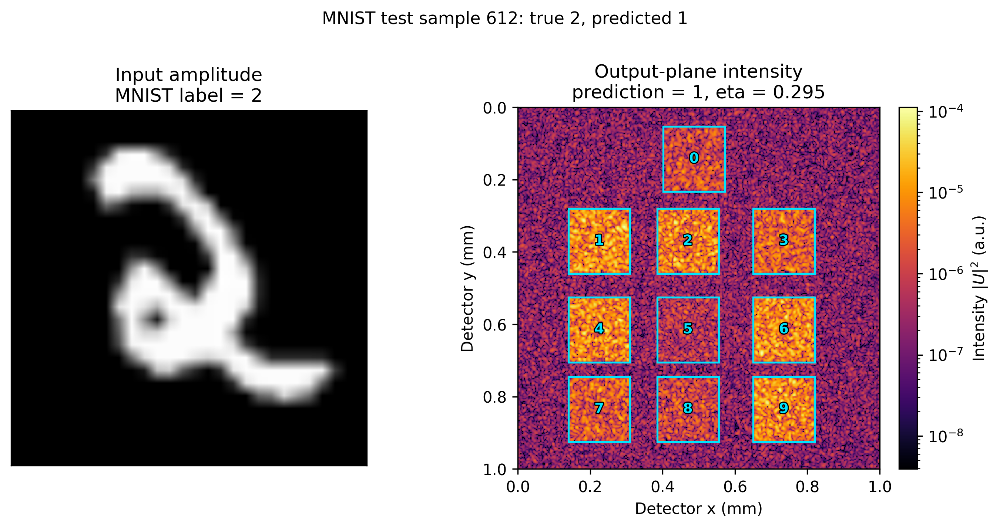
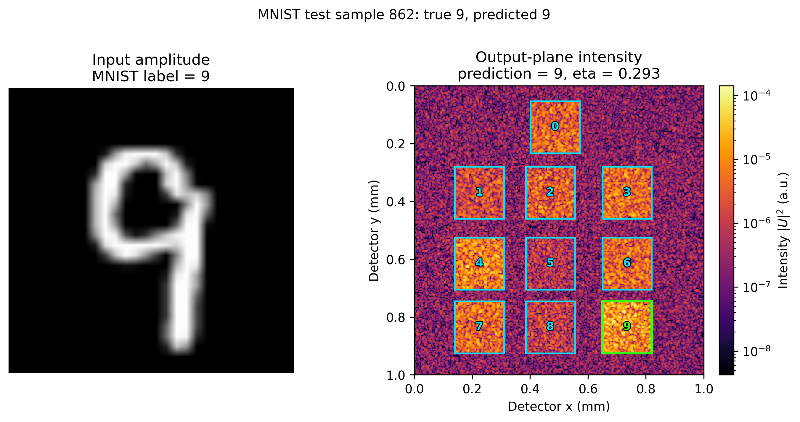

# 实验报告：MNIST 纯相位法 1% 数据训练与独立测试

> 范本说明：后续实验应保留本文件的章节结构，并替换实验身份、数据划分、复现信息、训练结果、独立测试和产物清单中的内容。

## 0. 摘要

本次实验在 MNIST 的 1% 训练集（600 张）和 1% 验证集（100 张）上训练纯相位 D2NN，共 20 个 epoch。最终随机抽取 50 张未参与训练和验证的官方测试集图像，评估最佳 checkpoint。独立测试准确率为 **44.00%**，平均损失为 **0.08429615**，平均汇聚效率为 **0.32054454**。

## 1. 实验身份

| 项目 | 值 |
|---|---|
| 实验名称 | MNIST 1% 数据纯相位法训练与独立测试 |
| 分支 | `纯相位法` |
| 运行标识 | `20261013-095617_mnist_1pct_pure_phase` |
| 报告生成时间 | 2026-10-13 10:32:26 |
| 训练输出目录 | `outputs/20261013-095617_mnist_5mm_2048pad_纯相位法_random-init_600samples_20epochs` |

## 2. 可复现信息

### 2.1 代码版本

| 项目 | 值 |
|---|---|
| Git 分支 | `纯相位法` |
| Git commit | `7a05e3e`（v0.4.0 基准提交） |
| 工作区状态 | `v0.4.0` 实验基准；详见 Git 标签和提交记录 |

关键代码文件 SHA256：

| 文件 | SHA256 |
|---|---|
| `scripts\train.py` | `a88de4bfacb373c6cf4f2a275aaeb979c9e3a109502f0e90e7d4b0926cf09fd1` |
| `src\d2nn\torch_model.py` | `72b77481acb2edced980650972906f1a4e3aef0eeac81c4ea8c7a17bbd52b320` |
| `src\d2nn\training.py` | `52351df050a1d06f93058d158a06d985999930a3c922ea05f7b7b65d8c86b14e` |
| `src\d2nn\config.py` | `a464a18f7eab59c9d044e89ef07495e6592f8a63039a72ac6265bed02f272dab` |

### 2.2 环境

```text
python=3.8.2
platform=Windows-10-10.0.22621-SP0
numpy=1.24.4
torch=2.2.2+cu121
torch_cuda=12.1
cuda_available=True
gpu=NVIDIA GeForce RTX 3060 Laptop GPU
```

### 2.3 随机种子

| 用途 | 种子 |
|---|---:|
| 模型相位初始化与训练 | 20261012 |
| 独立测试集抽取 | 20261013 |

## 3. 数据划分

| 数据集 | 来源 | 数量 | 选择方式 |
|---|---|---:|---|
| 训练集 | MNIST train | 600 | 取官方训练集索引 0..599，占 60000 的 1% |
| 验证集 | MNIST test | 100 | 取官方测试集索引 0..99，占 10000 的 1% |
| 独立测试集 | MNIST test 剩余部分 | 50 | 从测试集索引 100..9999 随机无放回抽取，种子 20261013 |

独立测试集和验证集没有重叠；验证集仅用于模型选择，没有参与参数梯度更新。

## 4. 模型与训练配置

- 衍射层数：5；
- 可训练参数：每层 400 x 400 相位，共 800000 个；
- 振幅透过率：固定为 1；
- 层间距：5 mm；
- 末层到探测面距离：10 mm；
- 计算网格：2048 x 2048；
- 优化器：Adam；
- 学习率：1e-2；
- 有效 batch size：32；
- micro-batch size：8；
- 梯度累积步数：4；
- epochs：20。

## 5. 复现命令

```powershell
python scripts/train.py --dataset mnist --data-root data --phase-only --phase-init random --padded-size 2048 --layer-spacing-mm 5 --detector-spacing-mm 10 --dataset-fraction 0.01 --epochs 20 --micro-batch-size 8 --effective-batch-size 32 --device cuda
```

## 6. 训练结果

| Epoch | Train loss | Validation loss | Validation accuracy | Validation eta | Seconds |
|---:|---:|---:|---:|---:|---:|
| 1 | 0.09992357 | 0.09990441 | 0.6100 | 0.00407534 | 80.66 |
| 2 | 0.09987147 | 0.09983818 | 0.6200 | 0.00596931 | 81.04 |
| 3 | 0.09977284 | 0.09971201 | 0.5200 | 0.00948689 | 82.35 |
| 4 | 0.09958405 | 0.09947039 | 0.4800 | 0.01599197 | 82.25 |
| 5 | 0.09923285 | 0.09903245 | 0.4200 | 0.02745897 | 82.61 |
| 6 | 0.09862759 | 0.09828254 | 0.3800 | 0.04595949 | 82.54 |
| 7 | 0.09766964 | 0.09724249 | 0.3800 | 0.07174475 | 82.68 |
| 8 | 0.09641831 | 0.09591050 | 0.3800 | 0.10227649 | 84.59 |
| 9 | 0.09499374 | 0.09452964 | 0.3900 | 0.13310506 | 84.16 |
| 10 | 0.09353557 | 0.09323005 | 0.4000 | 0.16077327 | 83.51 |
| 11 | 0.09220962 | 0.09191335 | 0.4100 | 0.18539650 | 83.52 |
| 12 | 0.09095715 | 0.09085851 | 0.4200 | 0.20607740 | 83.25 |
| 13 | 0.08985629 | 0.08986879 | 0.4500 | 0.22381338 | 75.70 |
| 14 | 0.08884859 | 0.08896105 | 0.4700 | 0.23904244 | 73.10 |
| 15 | 0.08795627 | 0.08819020 | 0.5000 | 0.25157570 | 72.85 |
| 16 | 0.08718260 | 0.08749758 | 0.5300 | 0.26261919 | 73.01 |
| 17 | 0.08646123 | 0.08687650 | 0.5300 | 0.27225955 | 75.23 |
| 18 | 0.08580305 | 0.08638222 | 0.5300 | 0.28046735 | 83.58 |
| 19 | 0.08522779 | 0.08582470 | 0.5800 | 0.28793071 | 77.03 |
| 20 | 0.08473727 | 0.08531536 | 0.5400 | 0.29435949 | 75.37 |

最佳验证结果：

- Epoch：20
- Validation loss：0.08531536
- Validation accuracy：0.5400
- Validation eta：0.29435949
- 训练总耗时：1599.04 秒

## 7. 独立测试结果

测试集：从未参与训练和验证的 MNIST 测试集索引中随机抽取 50 张，随机种子 `20261013`。

| 指标 | 值 |
|---|---:|
| 测试样本数 | 50 |
| 正确数 | 22 |
| Accuracy | 0.44000000 |
| Mean loss | 0.08429615 |
| Mean eta | 0.32054454 |
| Mean contrast | 3.34095004 |

### 7.1 逐样本结果

| # | MNIST test index | True | Predicted | Correct | Eta | Contrast |
|---:|---:|---:|---:|---|---:|---:|
| 1 | 612 | 2 | 1 | 否 | 0.29480220 | 1.111203 |
| 2 | 661 | 0 | 6 | 否 | 0.34722839 | 1.012637 |
| 3 | 741 | 2 | 1 | 否 | 0.29401781 | 3.007621 |
| 4 | 862 | 9 | 9 | 是 | 0.29346531 | 1.554408 |
| 5 | 902 | 4 | 9 | 否 | 0.25160824 | 1.609075 |
| 6 | 983 | 8 | 1 | 否 | 0.35319000 | 2.219698 |
| 7 | 994 | 1 | 1 | 是 | 0.25191658 | 2.249387 |
| 8 | 1066 | 3 | 1 | 否 | 0.27797905 | 1.613225 |
| 9 | 1180 | 1 | 1 | 是 | 0.35395712 | 5.715374 |
| 10 | 1450 | 6 | 0 | 否 | 0.21334355 | 1.694449 |
| 11 | 1563 | 7 | 1 | 否 | 0.35465515 | 1.146190 |
| 12 | 1867 | 1 | 1 | 是 | 0.38988014 | 10.815444 |
| 13 | 1893 | 8 | 1 | 否 | 0.37316824 | 2.336972 |
| 14 | 2417 | 0 | 0 | 是 | 0.23097451 | 2.694371 |
| 15 | 2782 | 6 | 0 | 否 | 0.32279958 | 1.006437 |
| 16 | 2937 | 0 | 0 | 是 | 0.35003847 | 1.838578 |
| 17 | 3142 | 2 | 1 | 否 | 0.35332992 | 1.147325 |
| 18 | 3217 | 3 | 1 | 否 | 0.25344230 | 1.476156 |
| 19 | 3231 | 1 | 1 | 是 | 0.34879673 | 5.407101 |
| 20 | 3325 | 0 | 0 | 是 | 0.35841749 | 3.210292 |
| 21 | 3606 | 1 | 1 | 是 | 0.31828357 | 18.856822 |
| 22 | 3638 | 1 | 1 | 是 | 0.45206535 | 18.328241 |
| 23 | 3884 | 9 | 0 | 否 | 0.20514918 | 1.318277 |
| 24 | 3970 | 9 | 1 | 否 | 0.42097833 | 1.109534 |
| 25 | 4094 | 5 | 9 | 否 | 0.29174208 | 1.056259 |
| 26 | 4301 | 9 | 6 | 否 | 0.30509899 | 1.003909 |
| 27 | 4715 | 7 | 7 | 是 | 0.19157789 | 1.042220 |
| 28 | 4951 | 1 | 1 | 是 | 0.21902178 | 5.192779 |
| 29 | 5293 | 3 | 0 | 否 | 0.34200659 | 1.480781 |
| 30 | 6334 | 6 | 6 | 是 | 0.34580323 | 1.377875 |
| 31 | 6350 | 6 | 6 | 是 | 0.30075972 | 1.889206 |
| 32 | 6821 | 3 | 0 | 否 | 0.25514736 | 1.102224 |
| 33 | 6872 | 4 | 6 | 否 | 0.33786438 | 1.033197 |
| 34 | 7037 | 0 | 0 | 是 | 0.32482961 | 1.612019 |
| 35 | 7714 | 3 | 1 | 否 | 0.24570193 | 1.219002 |
| 36 | 7763 | 3 | 1 | 否 | 0.38688455 | 1.025812 |
| 37 | 8016 | 0 | 0 | 是 | 0.32585836 | 2.485252 |
| 38 | 8062 | 5 | 1 | 否 | 0.35526444 | 3.102646 |
| 39 | 8128 | 1 | 1 | 是 | 0.42795398 | 9.979041 |
| 40 | 8187 | 1 | 1 | 是 | 0.35066984 | 8.169305 |
| 41 | 8440 | 8 | 9 | 否 | 0.32295430 | 1.011685 |
| 42 | 8570 | 3 | 0 | 否 | 0.17689082 | 1.083426 |
| 43 | 8673 | 2 | 2 | 是 | 0.40709112 | 1.058381 |
| 44 | 8724 | 1 | 1 | 是 | 0.43633577 | 19.468715 |
| 45 | 8805 | 7 | 7 | 是 | 0.32619789 | 1.036050 |
| 46 | 8853 | 5 | 1 | 否 | 0.29473159 | 1.353439 |
| 47 | 8932 | 8 | 9 | 否 | 0.36811858 | 1.024915 |
| 48 | 9736 | 6 | 0 | 否 | 0.31091441 | 1.403147 |
| 49 | 9813 | 4 | 4 | 是 | 0.28039624 | 1.800039 |
| 50 | 9832 | 2 | 1 | 否 | 0.43392413 | 2.557358 |

### 7.2 50 张测试样本的探测面光强分布


每幅子图对应一个独立测试样本，标题格式为“测试序号: MNIST索引 真实类别->预测类别”。图中青色方框和数字标出 10 个探测器区域 `0-9`；当该样本分类正确时，预测类别对应的数字方框和数字会改为亮绿色，未分类正确时所有探测区域均保持青色。每幅子图均按其自身最大光强归一化后使用对数色标显示，用于比较不同样本的分布形态。

### 7.3 测试样本探测器区域标注



该测试样本对应 MNIST test index `612`，真实类别为 `2`，模型预测为 `1`，汇聚效率为 `0.29480220`。图中青色方框为 10 个探测器区域；该样本分类错误，因此没有绿色高亮框。

### 7.4 分类成功样本的绿色高亮示例



该测试样本对应 MNIST test index `862`，真实类别为 `9`，模型预测为 `9`，汇聚效率为 `0.29346531`。由于分类正确，数字 `9` 对应的探测器区域方框和数字显示为亮绿色，其余区域保持青色。

## 8. 产物清单

| 产物 | 路径 |
|---|---|
| 最佳 checkpoint | `outputs/20261013-095617_mnist_5mm_2048pad_纯相位法_random-init_600samples_20epochs/20261013-095621_mnist_5mm_2048pad_纯相位法_random-init_600samples_20epochs_best.pt` |
| 最后 checkpoint | `outputs/20261013-095617_mnist_5mm_2048pad_纯相位法_random-init_600samples_20epochs/20261013-095621_mnist_5mm_2048pad_纯相位法_random-init_600samples_20epochs_last.pt` |
| 训练历史 | `outputs/20261013-095617_mnist_5mm_2048pad_纯相位法_random-init_600samples_20epochs/history.json` |
| 训练日志 | `outputs/20261013-095617_mnist_5mm_2048pad_纯相位法_random-init_600samples_20epochs/training.log` |
| 相位分布图 | `outputs/20261013-095617_mnist_5mm_2048pad_纯相位法_random-init_600samples_20epochs/phase_distribution.png` |
| 50 张测试样本探测面光强网格 | `outputs/20261013-095617_mnist_5mm_2048pad_纯相位法_random-init_600samples_20epochs/detector_intensity_test50_grid.png` |
| 测试样本 612 探测面光强及区域图 | `outputs/20261013-095617_mnist_5mm_2048pad_纯相位法_random-init_600samples_20epochs/detector_output_test612.png` |
| 测试样本 862 分类成功高亮图 | `outputs/20261013-095617_mnist_5mm_2048pad_纯相位法_random-init_600samples_20epochs/detector_output_test862.png` |
| 新数据集目录 | `data/experiments/20261013-095617_mnist_1pct_pure_phase` |
| 数据划分清单 | `data/experiments/20261013-095617_mnist_1pct_pure_phase/split_manifest.json` |
| 测试指标 JSON | `data/experiments/20261013-095617_mnist_1pct_pure_phase/test_metrics.json` |
| 测试预测 CSV | `data/experiments/20261013-095617_mnist_1pct_pure_phase/test_predictions.csv` |
| 混淆矩阵 NPY | `data/experiments/20261013-095617_mnist_1pct_pure_phase/test_confusion_matrix.npy` |

## 9. 复现步骤

1. 确认代码、环境和随机种子与本报告一致。
2. 使用第 3 节的数据划分；优先直接加载 `data/experiments/20261013-095617_mnist_1pct_pure_phase/split_manifest.json` 中记录的索引。
3. 执行第 5 节训练命令，生成 `history.json`、`_best.pt` 和 `_last.pt`。
4. 从官方测试集的剩余索引中按种子 `20261013` 抽取 50 张测试图像。
5. 使用最佳 checkpoint 评测并将逐样本结果写入 `test_predictions.csv`。
6. 报告训练与测试结果时同时报告 accuracy、loss、eta 和 contrast。

## 10. 结论与限制

本实验验证了纯相位法在 1% MNIST 数据上的完整训练和独立测试流程。训练集和验证集规模很小，且 50 张测试样本的统计方差较大，因此准确率不能直接代表完整 MNIST 测试集性能。后续对比实验应沿用本文件的数据划分、随机种子和评测字段。
