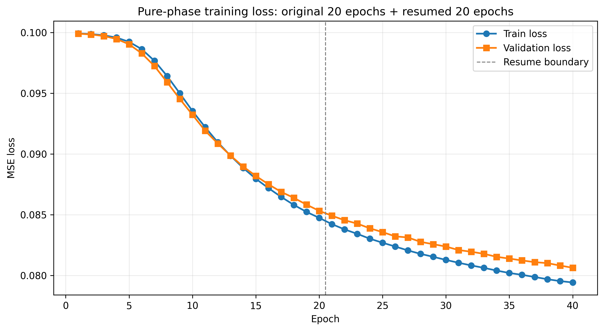
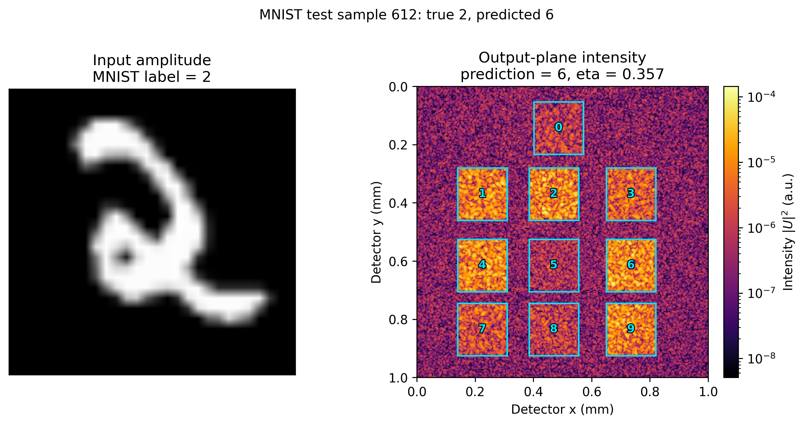
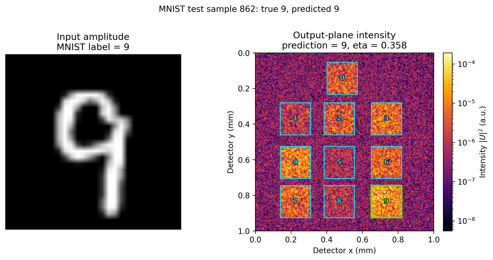

# 实验报告：纯相位法续训 20 epochs（前 20 + 本次 20）

> 范本说明：本模板以 `20261013-103219_result_20261013-095617_mnist_1pct_pure_phase_template.md` 为基准。后续实验必须保留可复现信息、数据划分、训练结果、独立测试、光强分布和产物清单。

## 0. 摘要

从最近一次纯相位训练的 `_last.pt` 恢复模型、优化器和历史记录，继续训练 20 个 epoch；完整历史共 40 个 epoch。最佳验证损失为 0.08062671，验证准确率为 68.00%，验证 eta 为 0.35691597；50 张独立测试样本准确率为 62.00%。

## 1. 实验身份

| 项目 | 值 |
|---|---|
| 实验名称 | 纯相位法原始 20 epoch + 续训 20 epoch |
| 分支 | `纯相位法` |
| 运行标识 | `20261013-161536_pure_phase_resume` |
| 报告生成时间 | 2026-10-13 16:49:46 |
| 训练输出目录 | `outputs/20261013-161536_mnist_5mm_2048pad_纯相位法_resume_600samples_20epochs` |

## 2. 可复现信息

- Git 分支：`纯相位法`
- Git commit：`2f0c2b3a897b5e18771d4b84f899a4093d48c3dc`
- 工作区状态：`见本次分支提交记录`
- Python 环境：Python 3.8.2；NumPy 1.24.4；PyTorch 2.2.2+cu121；CUDA 12.1；NVIDIA GeForce RTX 3060 Laptop GPU
- 训练种子：`20261012`
- 测试集抽样种子：`20261013`
- 关键代码 SHA256：scripts/train.py=4cb695d9385051898e045aebe6fdb5d43dd7b87367d72d2683ecb57388a4e2dd; src/d2nn/torch_model.py=e1689c6985d370ac3f78c57c7e59a9b1406cc99e1c63c879c910edbab56018e4; src/d2nn/training.py=0045f82c352e2db05ab867d6986123cbb2769b9df426f94f3bf73d211dcd64bc; src/d2nn/config.py=258dccf06062bf84cfd25de621954a56efe3f99f586729b01208e72a6b6e1733

## 3. 数据划分

| 数据集 | 来源 | 数量 | 选择方式 |
|---|---|---:|---|
| 训练集 | MNIST train | 600 | 官方训练索引 0..599 |
| 验证集 | MNIST test | 100 | 官方测试索引 0..99 |
| 独立测试集 | MNIST test 剩余部分 | 50 | 索引 100..9999 中按种子 20261013 随机无放回抽取 |

数据文件必须保存到 `data/experiments/20261013-161536_pure_phase_resume/`，至少包含 train、validation、test 的图像与标签、`split_manifest.json` 和 `dataset_card.md`。

## 4. 模型与训练配置

- 调制方式：纯相位法
- 5 个调制层，振幅透过率固定为 1
- 层间距 5 mm；末层到探测面 10 mm
- 计算网格 2048 x 2048
- 优化器 Adam，学习率 1e-2
- 有效 batch size 32；本次续训 micro-batch 8；梯度累积 4
- 本次续训 epochs 20；相位更新后 wrap 到 [0,2π)

## 5. 复现命令

```powershell
python scripts/train.py --dataset mnist --data-root data --phase-only --phase-init random --padded-size 2048 --layer-spacing-mm 5 --detector-spacing-mm 10 --dataset-fraction 0.01 --epochs 20 --micro-batch-size 8 --effective-batch-size 32 --resume-from "outputs/20261013-095617_mnist_5mm_2048pad_纯相位法_random-init_600samples_20epochs/20261013-095621_mnist_5mm_2048pad_纯相位法_random-init_600samples_20epochs_last.pt" --device cuda
```

## 6. 训练结果

| Epoch | Train loss | Validation loss | Validation accuracy | Validation eta | Seconds |
|---:|---:|---:|---:|---:|---:|
| 1 | 0.09992357 | 0.09990441 | 0.6100 | 0.00407534 | 80.66 |
| 2 | 0.09987147 | 0.09983818 | 0.6200 | 0.00596931 | 81.04 |
| 3 | 0.09977284 | 0.09971201 | 0.5200 | 0.00948689 | 82.35 |
| 4 | 0.09958405 | 0.09947039 | 0.4800 | 0.01599197 | 82.25 |
| 5 | 0.09923285 | 0.09903245 | 0.4200 | 0.02745897 | 82.61 |
| 6 | 0.09862759 | 0.09828254 | 0.3800 | 0.04595949 | 82.54 |
| 7 | 0.09766964 | 0.09724249 | 0.3800 | 0.07174475 | 82.68 |
| 8 | 0.09641831 | 0.09591050 | 0.3800 | 0.10227649 | 84.59 |
| 9 | 0.09499374 | 0.09452964 | 0.3900 | 0.13310506 | 84.16 |
| 10 | 0.09353557 | 0.09323005 | 0.4000 | 0.16077327 | 83.51 |
| 11 | 0.09220962 | 0.09191335 | 0.4100 | 0.18539650 | 83.52 |
| 12 | 0.09095715 | 0.09085851 | 0.4200 | 0.20607740 | 83.25 |
| 13 | 0.08985629 | 0.08986879 | 0.4500 | 0.22381338 | 75.70 |
| 14 | 0.08884859 | 0.08896105 | 0.4700 | 0.23904244 | 73.10 |
| 15 | 0.08795627 | 0.08819020 | 0.5000 | 0.25157570 | 72.85 |
| 16 | 0.08718260 | 0.08749758 | 0.5300 | 0.26261919 | 73.01 |
| 17 | 0.08646123 | 0.08687650 | 0.5300 | 0.27225955 | 75.23 |
| 18 | 0.08580305 | 0.08638222 | 0.5300 | 0.28046735 | 83.58 |
| 19 | 0.08522779 | 0.08582470 | 0.5800 | 0.28793071 | 77.03 |
| 20 | 0.08473727 | 0.08531536 | 0.5400 | 0.29435949 | 75.37 |
| 21 | 0.08422010 | 0.08491327 | 0.6000 | 0.30031828 | 118.65 |
| 22 | 0.08378658 | 0.08454404 | 0.6200 | 0.30544287 | 72.76 |
| 23 | 0.08341984 | 0.08426250 | 0.6200 | 0.30999820 | 72.95 |
| 24 | 0.08301850 | 0.08387264 | 0.6300 | 0.31482972 | 72.71 |
| 25 | 0.08268822 | 0.08356217 | 0.6400 | 0.31891043 | 72.51 |
| 26 | 0.08237584 | 0.08321318 | 0.6600 | 0.32279234 | 76.33 |
| 27 | 0.08205390 | 0.08312263 | 0.6400 | 0.32585448 | 72.26 |
| 28 | 0.08177000 | 0.08275810 | 0.6600 | 0.32931675 | 72.98 |
| 29 | 0.08152916 | 0.08256769 | 0.6600 | 0.33229107 | 73.63 |
| 30 | 0.08127254 | 0.08237278 | 0.6800 | 0.33490374 | 72.86 |
| 31 | 0.08103770 | 0.08208441 | 0.6700 | 0.33792377 | 74.61 |
| 32 | 0.08081818 | 0.08194546 | 0.6600 | 0.34046642 | 76.45 |
| 33 | 0.08061841 | 0.08177241 | 0.6800 | 0.34288082 | 79.17 |
| 34 | 0.08039533 | 0.08152716 | 0.6800 | 0.34535538 | 75.72 |
| 35 | 0.08019618 | 0.08138306 | 0.6800 | 0.34740414 | 74.42 |
| 36 | 0.08004491 | 0.08123043 | 0.6800 | 0.34929578 | 79.63 |
| 37 | 0.07986688 | 0.08108852 | 0.6800 | 0.35139114 | 76.27 |
| 38 | 0.07968416 | 0.08100944 | 0.6800 | 0.35321631 | 74.62 |
| 39 | 0.07952989 | 0.08080973 | 0.6800 | 0.35505968 | 72.92 |
| 40 | 0.07941667 | 0.08062671 | 0.6800 | 0.35691597 | 72.82 |

最佳验证结果：Epoch 40；Validation loss 0.08062671；Validation accuracy 0.6800；Validation eta 0.35691597；本次续训耗时 1534.26 秒。

### 6.1 Loss 曲线



曲线包含前 20 个 epoch 和本次续训 20 个 epoch，灰色虚线标出恢复训练边界。

## 7. 独立测试结果

测试集必须从未参与训练和验证的样本中按固定种子随机抽取，并记录索引。

| 指标 | 值 |
|---|---:|
| 测试样本数 | 50 |
| 正确数 | 31 |
| Accuracy | 0.62000000 |
| Mean loss | 0.08019382 |
| Mean eta | 0.38280051 |
| Mean contrast | 3.24846710 |

### 7.1 逐样本结果

| # | MNIST test index | True | Predicted | Correct | Eta | Contrast |
|---:|---:|---:|---:|---|---:|---:|
| 1 | 612 | 2 | 6 | 否 | 0.35670028 | 1.061952 |
| 2 | 661 | 0 | 6 | 否 | 0.40761408 | 1.182714 |
| 3 | 741 | 2 | 1 | 否 | 0.33845781 | 2.590879 |
| 4 | 862 | 9 | 9 | 是 | 0.35816026 | 1.553815 |
| 5 | 902 | 4 | 9 | 否 | 0.30591961 | 1.801221 |
| 6 | 983 | 8 | 1 | 否 | 0.40652211 | 2.005170 |
| 7 | 994 | 1 | 1 | 是 | 0.29515037 | 1.837656 |
| 8 | 1066 | 3 | 3 | 是 | 0.33287430 | 1.014711 |
| 9 | 1180 | 1 | 1 | 是 | 0.40418767 | 5.696847 |
| 10 | 1450 | 6 | 0 | 否 | 0.27103606 | 1.629214 |
| 11 | 1563 | 7 | 7 | 是 | 0.42721660 | 1.388689 |
| 12 | 1867 | 1 | 1 | 是 | 0.44304753 | 11.641151 |
| 13 | 1893 | 8 | 1 | 否 | 0.43209287 | 1.532141 |
| 14 | 2417 | 0 | 0 | 是 | 0.30287708 | 2.954754 |
| 15 | 2782 | 6 | 6 | 是 | 0.40424042 | 1.107310 |
| 16 | 2937 | 0 | 0 | 是 | 0.41703718 | 1.940010 |
| 17 | 3142 | 2 | 2 | 是 | 0.42230220 | 1.423655 |
| 18 | 3217 | 3 | 3 | 是 | 0.30737327 | 1.114587 |
| 19 | 3231 | 1 | 1 | 是 | 0.39818859 | 5.380654 |
| 20 | 3325 | 0 | 0 | 是 | 0.45982723 | 3.571840 |
| 21 | 3606 | 1 | 1 | 是 | 0.36481657 | 19.798381 |
| 22 | 3638 | 1 | 1 | 是 | 0.51250640 | 16.685273 |
| 23 | 3884 | 9 | 0 | 否 | 0.26397933 | 1.198217 |
| 24 | 3970 | 9 | 9 | 是 | 0.48862187 | 1.121341 |
| 25 | 4094 | 5 | 9 | 否 | 0.33956762 | 1.274780 |
| 26 | 4301 | 9 | 6 | 否 | 0.37080472 | 1.088852 |
| 27 | 4715 | 7 | 7 | 是 | 0.25204369 | 1.295949 |
| 28 | 4951 | 1 | 1 | 是 | 0.26080858 | 3.875315 |
| 29 | 5293 | 3 | 0 | 否 | 0.41469745 | 1.334716 |
| 30 | 6334 | 6 | 6 | 是 | 0.42860479 | 1.614486 |
| 31 | 6350 | 6 | 6 | 是 | 0.36902876 | 2.300807 |
| 32 | 6821 | 3 | 0 | 否 | 0.31493810 | 1.011448 |
| 33 | 6872 | 4 | 6 | 否 | 0.40930233 | 1.219647 |
| 34 | 7037 | 0 | 0 | 是 | 0.41225881 | 1.567036 |
| 35 | 7714 | 3 | 3 | 是 | 0.29523118 | 1.313164 |
| 36 | 7763 | 3 | 3 | 是 | 0.46376110 | 1.641734 |
| 37 | 8016 | 0 | 0 | 是 | 0.41065687 | 2.807340 |
| 38 | 8062 | 5 | 1 | 否 | 0.40760712 | 2.674740 |
| 39 | 8128 | 1 | 1 | 是 | 0.48709440 | 8.009678 |
| 40 | 8187 | 1 | 1 | 是 | 0.40367962 | 6.571860 |
| 41 | 8440 | 8 | 9 | 否 | 0.37577528 | 1.230597 |
| 42 | 8570 | 3 | 3 | 是 | 0.23284832 | 1.157704 |
| 43 | 8673 | 2 | 2 | 是 | 0.48157539 | 1.192924 |
| 44 | 8724 | 1 | 1 | 是 | 0.49485718 | 18.889788 |
| 45 | 8805 | 7 | 7 | 是 | 0.39466123 | 1.414836 |
| 46 | 8853 | 5 | 1 | 否 | 0.34638721 | 1.059988 |
| 47 | 8932 | 8 | 9 | 否 | 0.42864696 | 1.102300 |
| 48 | 9736 | 6 | 0 | 否 | 0.37624667 | 1.361814 |
| 49 | 9813 | 4 | 4 | 是 | 0.34982702 | 2.055510 |
| 50 | 9832 | 2 | 1 | 否 | 0.49836568 | 2.124160 |

### 7.2 探测面光强分布总图


50 张测试样本的探测面光强总图；青色方框和数字表示 10 个探测器区域，分类正确时预测类别对应框为亮绿色。

### 7.3 分类错误示例



测试样本 612：真实类别 2，预测类别 6，用于展示分类失败情况。

### 7.4 分类成功示例



测试样本 862：真实类别 9，预测类别 9，用于展示分类成功情况。

## 8. 产物清单

| 产物 | 路径 |
|---|---|
| 最佳 checkpoint | `outputs/20261013-161536_mnist_5mm_2048pad_纯相位法_resume_600samples_20epochs/20261013-161541_mnist_5mm_2048pad_纯相位法_resume_random-init_600samples_20epochs_best.pt` |
| 最后 checkpoint | `outputs/20261013-161536_mnist_5mm_2048pad_纯相位法_resume_600samples_20epochs/20261013-161541_mnist_5mm_2048pad_纯相位法_resume_random-init_600samples_20epochs_last.pt` |
| 完整训练历史 | `outputs/20261013-161536_mnist_5mm_2048pad_纯相位法_resume_600samples_20epochs/history.json` |
| 合并 Loss 曲线 | `docs/assets/20261013-161536_pure_phase_resume_training_loss_curve.png` |
| 测试指标 | `outputs/20261013-161536_mnist_5mm_2048pad_纯相位法_resume_600samples_20epochs/test_metrics.json` |
| 逐样本预测 | `outputs/20261013-161536_mnist_5mm_2048pad_纯相位法_resume_600samples_20epochs/test_predictions.csv` |
| 探测面总图 | `docs/assets/20261013-161536_pure_phase_resume_detector_intensity_test50_grid.png` |
| 失败示例图 | `docs/assets/20261013-161536_pure_phase_resume_detector_output_test612.png` |
| 成功示例图 | `docs/assets/20261013-161536_pure_phase_resume_detector_output_test862.png` |
| 相位分布图 | `docs/assets/20261013-161536_pure_phase_resume_phase_distribution.png` |

产物清单必须包含 loss 曲线图片及其路径。

## 9. 复现步骤

1. 切换到 `纯相位法` 分支并确认固定数据划分。
2. 使用第 5 节命令从最近一次 `_last.pt` 恢复训练。
3. 使用最佳 checkpoint 评测 50 张独立测试样本。
4. 生成合并 loss 曲线、探测面光强图和相位分布图。
5. 按本模板报告 accuracy、loss、eta 和 contrast。

## 10. 结论与限制

续训后验证准确率提升到 68.00%，独立测试准确率提升到 62.00%，loss 明显下降。当前测试集规模仅 50 张，统计方差仍较大；后续实验应保持相同数据划分和恢复边界，便于公平比较。
