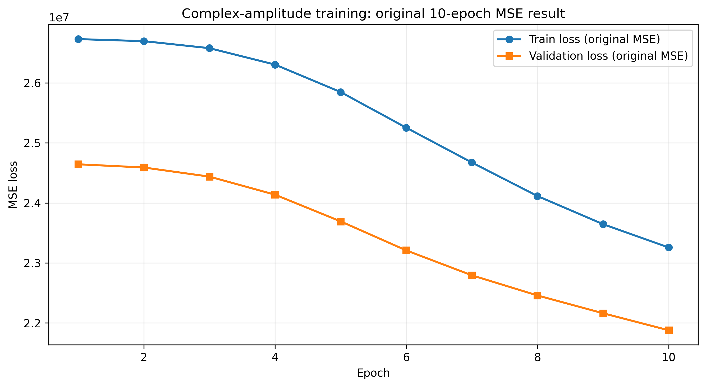
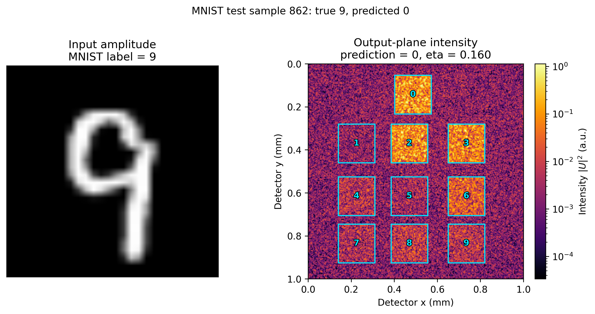
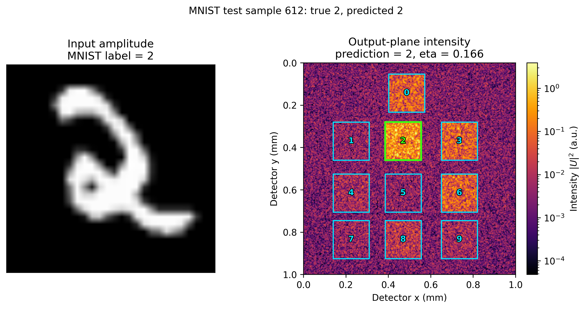

# 实验报告：灰度输入直接作为振幅的复振幅调制实验（保留原始 MSE 结果）

> 范本说明：本模板以 `20261013-103219_result_20261013-095617_mnist_1pct_pure_phase_template.md` 为基准。后续实验必须保留可复现信息、数据划分、训练结果、独立测试、光强分布和产物清单。

## 0. 摘要

本次保留实验使用原始灰度值作为输入振幅、不做逐样本归一化，使用 MSE 训练 10 个 epoch。独立测试准确率为 20.00%，平均 eta 为 0.19731368。训练完成后，代码已将后续训练损失改为交叉熵 + 按 P_in² 归一化的 MSE。

## 1. 实验身份

| 项目 | 值 |
|---|---|
| 实验名称 | 灰度直接作为振幅的复振幅调制（10 epochs，原始 MSE） |
| 分支 | `main` |
| 运行标识 | `20261014-202951_gray_amplitude_ce_mse` |
| 报告生成时间 | 2026-10-14 21:07:31 |
| 训练输出目录 | `outputs/20261014-202951_mnist_5mm_2048pad_复振幅调制_gray-amplitude_600samples_10epochs` |

## 2. 可复现信息

- Git 分支：`main`
- Git commit：`d6c8e82d9a43df3c8003be25951f0c47b2106ed4`
- 工作区状态：`见本次工作区状态`
- Python 环境：Python 3.8.2；NumPy 1.24.4；PyTorch 2.2.2+cu121；CUDA 12.1；NVIDIA GeForce RTX 3060 Laptop GPU
- 训练种子：`20261012`
- 测试集抽样种子：`20261013`
- 关键代码 SHA256：scripts/train.py=96149b27a536c4b71e2344768810c22098191719c1f33598d71ee68133c3c458; src/d2nn/torch_model.py=05f6a93c81c2a5fbb2088b0c3f88de63a87f2d75ea858998df00f688f2c5a518; src/d2nn/training.py=00d2111101270bda537ddb9504a94dc55bb59986861ae9c0e2adeabfe0da3375; src/d2nn/config.py=1ff8359d11300b55273d08c5c9fddbd130c07b2a682a0701408972c7ea624f19; src/d2nn/data.py=d4fa6cb65fc25cb5a1b0c7b2d485cf00693e25356a38d66e557af0b88d5ff262

## 3. 数据划分

| 数据集 | 来源 | 数量 | 选择方式 |
|---|---|---:|---|
| 训练集 | MNIST train | 600 | 官方训练索引 0..599 |
| 验证集 | MNIST test | 100 | 官方测试索引 0..99 |
| 独立测试集 | MNIST test 剩余部分 | 50 | 索引 100..9999 中按种子 20261013 随机无放回抽取 |

数据文件必须保存到 `data/experiments/20261014-202951_gray_amplitude_ce_mse/`，至少包含 train、validation、test 的图像与标签、`split_manifest.json` 和 `dataset_card.md`。

## 4. 模型与训练配置

- 调制方式：复振幅调制，相位与振幅联合优化
- 输入：MNIST 灰度图直接作为输入振幅，不做功率归一化
- 输入功率：每个样本的 P_in=sum|I|²
- 衍射层：5；调制振幅初值：0.8
- 本次保留实验的 loss：原始 MSE，目标 g_k=P_inδ(k,c)
- 后续代码 loss：交叉熵 + 按 P_in² 归一化的 MSE
- 层间距 5 mm，末层到探测面 10 mm；计算网格 2048x2048
- 有效 batch size 32；micro-batch 8；epochs 10

## 5. 复现命令

```powershell
python scripts/train.py --dataset mnist --data-root data --padded-size 2048 --layer-spacing-mm 5 --detector-spacing-mm 10 --dataset-fraction 0.01 --epochs 10 --micro-batch-size 8 --effective-batch-size 32 --optimize-amplitude --amplitude-init 0.8 --device cuda
```

## 6. 训练结果

| Epoch | Train loss | Validation loss | Validation accuracy | Validation eta | Mean Pin | Seconds |
|---:|---:|---:|---:|---:|---:|---:|
| 1 | 26730559.70620823 | 24643927.80232961 | 0.1500 | 0.00139731 | 14567.9329 | 74.76 |
| 2 | 26696692.27043361 | 24590482.56634066 | 0.0800 | 0.00521082 | 14567.9329 | 70.61 |
| 3 | 26579688.88142290 | 24438329.10160905 | 0.0800 | 0.01517151 | 14567.9329 | 72.15 |
| 4 | 26305803.49619721 | 24137269.91341278 | 0.0800 | 0.03391451 | 14567.9329 | 72.91 |
| 5 | 25848124.08904479 | 23692573.45732112 | 0.0800 | 0.06099613 | 14567.9329 | 76.08 |
| 6 | 25254156.61095614 | 23208588.20971662 | 0.0800 | 0.08951425 | 14567.9329 | 74.60 |
| 7 | 24674007.94030768 | 22793575.18204299 | 0.1100 | 0.11663540 | 14567.9329 | 78.02 |
| 8 | 24114941.98593433 | 22457482.21427924 | 0.1100 | 0.13985130 | 14567.9329 | 75.86 |
| 9 | 23646207.16486295 | 22160990.48786528 | 0.1200 | 0.16079143 | 14567.9329 | 75.70 |
| 10 | 23257166.50894458 | 21877258.45830780 | 0.1400 | 0.17914456 | 14567.9329 | 77.38 |

最佳验证结果为 Epoch 10：validation loss 21877258.45830780，validation accuracy 0.1400，validation eta 0.17914456。

### 6.1 Loss 曲线



该曲线保留本次实验实际使用的原始 MSE 训练结果，没有用新损失重训或覆盖 checkpoint。

## 7. 独立测试结果

测试集必须从未参与训练和验证的样本中按固定种子随机抽取，并记录索引。

| 指标 | 值 |
|---|---:|
| 测试样本数 | 50 |
| 正确数 | 10 |
| Accuracy | 0.20000000 |
| Mean cross-entropy | 867.27745867 |
| Mean raw MSE | 24190835.08751879 |
| Mean normalized MSE | 0.09258734 |
| Mean combined loss | 867.37004601 |
| Mean eta | 0.19731368 |
| Mean contrast | 2.44342103 |

### 7.1 逐样本结果

| # | MNIST test index | True | Predicted | Correct | Eta | Contrast |
|---:|---:|---:|---:|---|---:|---:|
| 1 | 612 | 2 | 2 | 是 | 0.16569496 | 3.738924 |
| 2 | 661 | 0 | 0 | 是 | 0.22285790 | 1.985363 |
| 3 | 741 | 2 | 2 | 是 | 0.14267538 | 1.387418 |
| 4 | 862 | 9 | 0 | 否 | 0.16001862 | 1.222693 |
| 5 | 902 | 4 | 3 | 否 | 0.11224614 | 1.441216 |
| 6 | 983 | 8 | 0 | 否 | 0.20203596 | 1.064373 |
| 7 | 994 | 1 | 0 | 否 | 0.12955020 | 1.010937 |
| 8 | 1066 | 3 | 3 | 是 | 0.15218341 | 1.426547 |
| 9 | 1180 | 1 | 2 | 否 | 0.12845199 | 1.155171 |
| 10 | 1450 | 6 | 0 | 否 | 0.19255008 | 2.286719 |
| 11 | 1563 | 7 | 0 | 否 | 0.13700622 | 1.972470 |
| 12 | 1867 | 1 | 2 | 否 | 0.10501099 | 1.299443 |
| 13 | 1893 | 8 | 0 | 否 | 0.23802222 | 1.256279 |
| 14 | 2417 | 0 | 0 | 是 | 0.25729406 | 6.551240 |
| 15 | 2782 | 6 | 0 | 否 | 0.27832337 | 4.469662 |
| 16 | 2937 | 0 | 0 | 是 | 0.28610694 | 3.912205 |
| 17 | 3142 | 2 | 2 | 是 | 0.25550329 | 2.008646 |
| 18 | 3217 | 3 | 0 | 否 | 0.18262200 | 2.116607 |
| 19 | 3231 | 1 | 2 | 否 | 0.12290516 | 1.183897 |
| 20 | 3325 | 0 | 0 | 是 | 0.40688465 | 8.254608 |
| 21 | 3606 | 1 | 2 | 否 | 0.08482333 | 1.184189 |
| 22 | 3638 | 1 | 2 | 否 | 0.12437283 | 1.977515 |
| 23 | 3884 | 9 | 0 | 否 | 0.17680586 | 1.637135 |
| 24 | 3970 | 9 | 2 | 否 | 0.16665056 | 1.031530 |
| 25 | 4094 | 5 | 0 | 否 | 0.17331681 | 3.595471 |
| 26 | 4301 | 9 | 0 | 否 | 0.21860227 | 2.485412 |
| 27 | 4715 | 7 | 0 | 否 | 0.12598839 | 3.586045 |
| 28 | 4951 | 1 | 2 | 否 | 0.10135100 | 2.277697 |
| 29 | 5293 | 3 | 0 | 否 | 0.29776243 | 3.817356 |
| 30 | 6334 | 6 | 0 | 否 | 0.26701842 | 2.461233 |
| 31 | 6350 | 6 | 0 | 否 | 0.20085786 | 1.331712 |
| 32 | 6821 | 3 | 0 | 否 | 0.20671477 | 3.235330 |
| 33 | 6872 | 4 | 0 | 否 | 0.20800956 | 1.064214 |
| 34 | 7037 | 0 | 0 | 是 | 0.32637397 | 7.261747 |
| 35 | 7714 | 3 | 0 | 否 | 0.16456620 | 1.999809 |
| 36 | 7763 | 3 | 0 | 否 | 0.28306271 | 1.531460 |
| 37 | 8016 | 0 | 0 | 是 | 0.31749382 | 5.451263 |
| 38 | 8062 | 5 | 0 | 否 | 0.21217789 | 1.776918 |
| 39 | 8128 | 1 | 2 | 否 | 0.14921735 | 2.555572 |
| 40 | 8187 | 1 | 2 | 否 | 0.13785554 | 1.998507 |
| 41 | 8440 | 8 | 0 | 否 | 0.19253997 | 2.374442 |
| 42 | 8570 | 3 | 0 | 否 | 0.15935775 | 2.237888 |
| 43 | 8673 | 2 | 0 | 否 | 0.30463810 | 1.087342 |
| 44 | 8724 | 1 | 2 | 否 | 0.11735336 | 1.723262 |
| 45 | 8805 | 7 | 0 | 否 | 0.13776886 | 1.088062 |
| 46 | 8853 | 5 | 0 | 否 | 0.19801464 | 2.940792 |
| 47 | 8932 | 8 | 0 | 否 | 0.24576860 | 1.738185 |
| 48 | 9736 | 6 | 0 | 否 | 0.26556174 | 3.616327 |
| 49 | 9813 | 4 | 2 | 否 | 0.14631852 | 1.020086 |
| 50 | 9832 | 2 | 0 | 否 | 0.27739734 | 2.340133 |

### 7.2 探测面光强分布总图


50 张测试样本的探测面光强总图；青色方框和数字表示探测器区域，分类正确时对应数字区域为亮绿色。

### 7.3 分类错误示例



测试样本 862：真实类别 9，预测类别 0，用于展示分类失败。

### 7.4 分类成功示例



测试样本 612：真实类别 2，预测类别 2，用于展示分类成功。

## 8. 产物清单

| 产物 | 路径 |
|---|---|
| 最佳 checkpoint | `outputs/20261014-202951_mnist_5mm_2048pad_复振幅调制_gray-amplitude_600samples_10epochs/20261014-202957_mnist_5mm_2048pad_复振幅预训练_fresh_random-init_600samples_10epochs_best.pt` |
| 最后 checkpoint | `outputs/20261014-202951_mnist_5mm_2048pad_复振幅调制_gray-amplitude_600samples_10epochs/20261014-202957_mnist_5mm_2048pad_复振幅预训练_fresh_random-init_600samples_10epochs_last.pt` |
| 训练历史 | `outputs/20261014-202951_mnist_5mm_2048pad_复振幅调制_gray-amplitude_600samples_10epochs/history.json` |
| 原始 MSE loss 曲线 | `docs/assets/20261014-202951_gray_amplitude_ce_mse_training_loss_curve.png` |
| 测试指标 | `outputs/20261014-202951_mnist_5mm_2048pad_复振幅调制_gray-amplitude_600samples_10epochs/test_metrics.json` |
| 逐样本预测 | `outputs/20261014-202951_mnist_5mm_2048pad_复振幅调制_gray-amplitude_600samples_10epochs/test_predictions.csv` |
| 探测面总图 | `docs/assets/20261014-202951_gray_amplitude_ce_mse_detector_intensity_test50_grid.png` |
| 成功示例 | `docs/assets/20261014-202951_gray_amplitude_ce_mse_detector_output_test612.png` |
| 失败示例 | `docs/assets/20261014-202951_gray_amplitude_ce_mse_detector_output_test862.png` |
| 相位/振幅分布 | `docs/assets/20261014-202951_gray_amplitude_ce_mse_phase_amplitude_distribution.png` |

产物清单必须包含 loss 曲线图片及其路径。

## 9. 复现步骤

1. 加载固定数据划分和灰度输入。
2. 使用原始 MSE 训练配置生成并保留本次 10-epoch checkpoint。
3. 使用最佳 checkpoint 评测 50 张独立测试样本。
4. 生成 loss 曲线、相位/振幅分布和探测面光强图。
5. 后续训练使用新的交叉熵 + 归一化 MSE loss。

## 10. 结论与限制

本次保留了原始 MSE 训练结果，测试准确率为 20.00%，说明绝对光强 MSE 与分类准确率并不完全一致。新的交叉熵 + 归一化 MSE 已写入模型代码，但未用于覆盖本次 checkpoint；后续应单独训练并比较两种损失函数的验证准确率和收敛速度。
