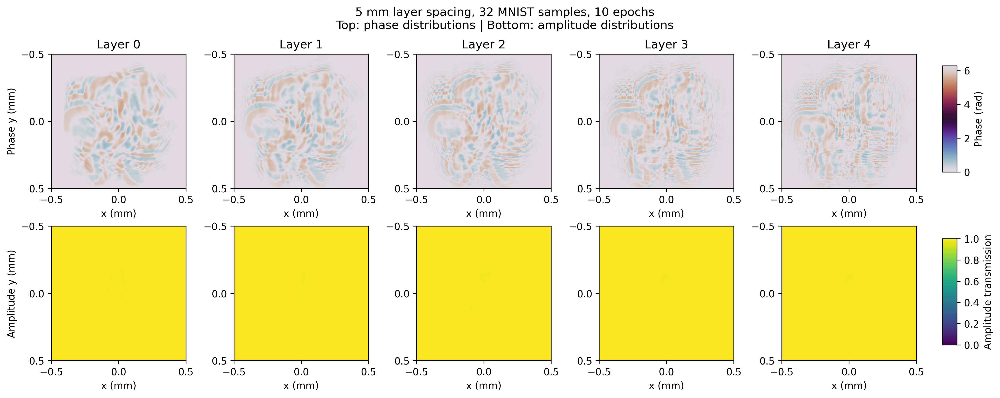

# 5 mm 层间距相位/振幅训练结果

日期：2026-10-12

## 1. 训练配置

- 数据集：MNIST；
- 训练样本：32；
- 验证样本：6；
- 层间距：5 mm；
- 最后一层到探测面：10 mm；
- 零填充：4096；
- micro-batch：2；
- 有效 batch：8；
- 初始化：零相位，初始振幅约 0.99；
- 优化器：Adam；
- 学习率：0.02；
- epoch：10；
- 优化参数：相位 + 振幅。

## 2. 训练曲线数据

| epoch | train loss | validation loss | validation accuracy | eta |
|---:|---:|---:|---:|---:|
| 1 | 0.096792 | 0.098743 | 0.0000 | 0.429748 |
| 2 | 0.095272 | 0.098675 | 0.0000 | 0.422883 |
| 3 | 0.093857 | 0.098570 | 0.0000 | 0.428965 |
| 4 | 0.092327 | 0.098504 | 0.0000 | 0.441164 |
| 5 | 0.090735 | 0.098320 | 0.0000 | 0.456848 |
| 6 | 0.089111 | 0.098020 | 0.0000 | 0.475055 |
| 7 | 0.087229 | 0.097547 | 0.0000 | 0.491962 |
| 8 | 0.085364 | 0.096805 | 0.0000 | 0.507896 |
| 9 | 0.083535 | 0.095983 | 0.0000 | 0.523160 |
| 10 | 0.081841 | 0.094920 | 0.0000 | 0.534976 |

训练 loss 从 0.096792 降到 0.081841，eta 从 0.429748 升到 0.534976。验证集只有 6 个样本，当前验证准确率不具备统计意义。

## 3. 相位与振幅分布

*图 1：上排为 5 个衍射层的相位分布，单位为 rad，使用周期色标；下排为对应的振幅透过率分布，范围为 [0, 1]。*

最终 checkpoint 的统计量：

- 相位范围：0.000000–6.283185 rad；
- 相位均值：2.906497 rad；
- 振幅范围：0.984950–0.993147；
- 振幅均值：0.990224。

## 4. 产物位置

- checkpoint：`outputs/train_5mm_phase_amplitude_32/last_checkpoint.pt`
- 相位/振幅分布 PNG：`docs/assets/phase_amplitude_distribution_5mm_32samples_10epochs.png`
- 相位/振幅分布 PDF：`docs/assets/phase_amplitude_distribution_5mm_32samples_10epochs.pdf`

## 5. 结论与限制

当前训练验证了 5 mm 层间距下相位和振幅联合优化链路可用，且训练 loss 和 eta 在 10 epoch 内持续改善。由于本机只有 6 GB 显存，本轮采用 32 个样本的小规模训练，不是最终精度实验。下一步应扩大训练样本数和 epoch，并在更大显存设备上执行完整 MNIST 训练。
