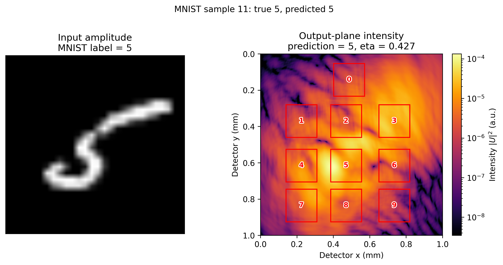

# MNIST 首轮训练验证

日期：2026-10-12

## 1. 数据和运行条件

MNIST 已下载到：

`E:\codes\D2NN\data\MNIST`

运行环境：

- Python 3.8.2；
- torch 2.2.2+cu121；
- RTX 3060 Laptop 6 GB；
- `Npad=4096`；
- micro-batch=2。

## 2. 初始相位梯度诊断

对真实 MNIST 输入比较了两种初始化：

| 初始化 | eta 示例 | 初始 loss | 平均绝对梯度 | 最大绝对梯度 |
|---|---:|---:|---:|---:|
| 随机 [0, 2π) | ~3e-5 | 0.099999 | 3.64e-11 | 8.02e-10 |
| 零相位 | 0.44–0.47 | 0.09178 | 1.44e-7 | 3.47e-6 |

随机初始化会把绝大部分能量散射到探测器区域之外，使目标信号和梯度都极小。零相位初始化虽然仍然较慢，但梯度尺度高约四个数量级，适合作为本地可行性验证的起点。

## 3. 32 样本零初始化过拟合

配置：

- 训练样本：32；
- 验证样本：6；
- `Npad=4096`；
- micro-batch=2；
- 有效 batch=8；
- Adam，学习率 1e-2；
- 5 epoch。

结果：

| epoch | train loss | validation loss | validation accuracy | eta | epoch 时间/s |
|---:|---:|---:|---:|---:|---:|
| 1 | 0.095670 | 0.098017 | 0.0000 | 0.4707 | 18.85 |
| 2 | 0.094737 | 0.097926 | 0.0000 | 0.4660 | 18.68 |
| 3 | 0.093852 | 0.097859 | 0.0000 | 0.4653 | 19.50 |
| 4 | 0.092949 | 0.097817 | 0.0000 | 0.4661 | 20.02 |
| 5 | 0.092027 | 0.097777 | 0.0000 | 0.4685 | 19.67 |

训练 loss 和验证 loss 都在下降，说明真实数据和梯度链路有效。验证集只有 6 个样本，验证准确率暂时没有统计意义，不能据此判断模型能力。

## 4. 输出面光强分布

使用 `outputs/mnist_overfit_zero_32/last_checkpoint.pt` 和 MNIST 样本索引 11 生成。该样本真实数字为 5，模型预测为 5，探测器总汇聚效率 eta=0.426587。



*图 1：左侧为输入振幅，右侧为探测面 400×400 光强分布。红色方框标出数字 0–9 对应的矩形探测区域，框内数字为对应类别。右图使用对数强度标度。*

## 5. 结论


1. `Npad=4096` 的本地训练路径已经可运行。
2. 随机相位初始化不适合当前本地小规模过拟合验证，零相位初始化更稳定。
3. 纯相位模型从零相位开始收敛很慢；32 样本 5 epoch 只改变了约 0.0036 的训练 loss。
4. 下一步最有价值的工作是实现可选的复数振幅+相位预训练，再把振幅投影为 1，并比较投影前后的 loss、eta 和准确率。
5. 200 epoch、60000 样本全量训练不适合当前 6 GB 显存设备直接执行；应使用更大显存设备，或明确采用降规模协议。

## 6. 复现命令

```powershell
E:\codes\env\STME-main\Scripts\python.exe scripts\train.py ^
  --dataset mnist ^
  --data-root data ^
  --padded-size 4096 ^
  --micro-batch-size 2 ^
  --effective-batch-size 8 ^
  --phase-init zero ^
  --limit 32 ^
  --epochs 5 ^
  --output-dir outputs\mnist_overfit_zero_32 ^
  --device cuda
```
